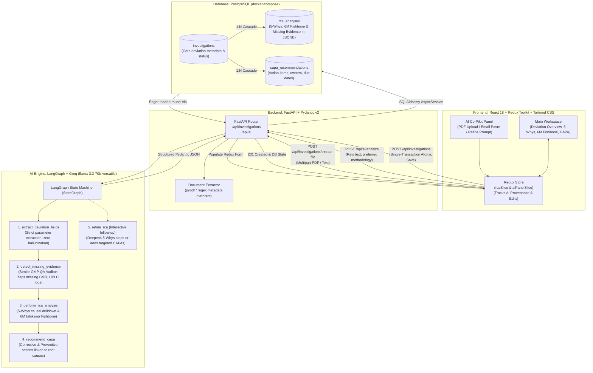

# AI-Powered Root Cause Analysis (RCA) Module
### Pharmaceutical Active Pharmaceutical Ingredient (API) Manufacturing (GMP / ICH Q7 Context)

A compliance-ready Root Cause Analysis (RCA) and Corrective & Preventive Action (CAPA) platform engineered for pharmaceutical Active Pharmaceutical Ingredient (API) manufacturing plants adhering to **ICH Q7** (GMP for APIs), **ICH Q9** (Quality Risk Management), **ICH Q10** (Pharmaceutical Quality System), and **21 CFR Part 11** electronic records standards.

---

## Architecture Flow Diagram



---

## Mandatory Tech Stack

- **Frontend**: React 18, Vite, Redux Toolkit, Tailwind CSS, Lucide Icons, TypeScript
- **Backend**: Python 3.11, FastAPI, SQLAlchemy 2.0 (Async + Sync), Pydantic v2, Alembic
- **AI Workflow**: LangGraph (`StateGraph`), Groq (`llama-3.3-70b-versatile`), LangChain Core
- **Database**: PostgreSQL 16 (JSONB for 6M Ishikawa data, 5-Whys causal chains, missing evidence, and QA verified root causes)

---

## Key Differentiators & Compliance Features

1. **AI-First Form-Filling**: Users don't manually type forms from scratch. Ingesting a PDF deviation or raw email automatically extracts fields, detects critical gaps, conducts 5-Whys and Fishbone analyses, and drafts CAPA recommendations.
2. **AI Provenance & Edit Tracking**: Every auto-filled field is labeled with an `"AI Extracted"` badge. As soon as a QA reviewer edits a field, it seamlessly updates to `"Edited"`. Missing required fields are highlighted in amber.
3. **Missing Evidence & Audit Gap Detector**: Acts as a Senior GMP QA Auditor, immediately highlighting missing records (e.g., missing BMR pages, missing HPLC chromatograms, missing calibration certificates, missing environmental monitoring logs) before signing off on root causes.
4. **Mandatory QA Verification of AI Root Causes**: In compliance with cGMP / 21 CFR Part 11, all AI-generated causes default to `"Suggested – Unverified"`. A Qualified Person must explicitly check `"Confirm Root Cause (QA Verified)"` and record supporting evidence.
5. **Interactive Dual Methodology (5-Whys + 6M Fishbone)**:
   - **5-Whys**: Connected vertical stepper with inline editing, step deepening via AI, and dynamic level management.
   - **Fishbone (6M)**: Interactive 6-category diagram (Man, Machine, Material, Method, Measurement, Environment) with factor editing and tag deletion.
6. **Single-Transaction Persistence**: Atomically saves the complete reviewed deviation, RCA analyses, and CAPA recommendations in a single ACID transaction to PostgreSQL.

---

## Quickstart Guide

### 1. Database (Docker Compose)
Start the PostgreSQL container:
```bash
docker-compose up -d
```
Verify the container is healthy:
```bash
docker-compose ps
```

### 2. Backend Setup
```bash
cd backend
python3 -m venv venv
source venv/bin/activate
pip install -r requirements.txt

# Run database migrations
alembic upgrade head

# Seed initial ICH Q7 sample deviation
python -m app.services.seed_data

# Run all unit and integration tests (21 tests)
pytest -v

# Start FastAPI server
uvicorn app.main:app --reload --host 127.0.0.1 --port 8000
```

Verify backend health at:
- Health check: `http://127.0.0.1:8000/health`
- Interactive OpenAPI Docs: `http://127.0.0.1:8000/docs`

### 3. Frontend Setup
```bash
cd frontend
npm install
npm run build   # Type-check and verify production build
npm run dev     # Starts Vite development server
```
Open `http://localhost:5173` in your browser.

### 4. End-to-End Automated Verification Script
Run the automated test validating the entire pipeline (PDF extraction $\rightarrow$ LangGraph AI $\rightarrow$ Human edits $\rightarrow$ QA confirmation $\rightarrow$ Atomic PostgreSQL save $\rightarrow$ Re-fetch round-trip):
```bash
backend/venv/bin/python scripts/verify_e2e.py
```

---

## Realistic Sample Scenarios (`sample_data/`)

The local `sample_data/` directory contains 3 realistic pharmaceutical manufacturing incidents, each engineered with **2–3 intentional missing GMP records** to demonstrate the AI Missing Evidence Detector:

| Scenario File | API Product & Process | Deviation Description | Intentionally Missing GMP Records |
|---|---|---|---|
| **`deviation_oos_assay.pdf`** | Atorvastatin Calcium Trihydrate<br>(Reaction / Controlled Crystallization) | HPLC Assay Out of Specification (94.2% vs 98.0–102.0% limit) after reactor jacket thermal excursion (+14.2°C). | 1. Sensor calibration certificate for thermocouple `TT-104`<br>2. Shift operator training record on cooling valve manual bypass<br>3. Raw HPLC raw chromatograms & system suitability run data |
| **`incident_email_impurity.txt`** | Losartan Potassium<br>(Vacuum Tray Drying) | Related Substance Impurity D spike (0.28% vs 0.15% limit) following unapproved switch of solvent supplier lot. | 1. Supplier Certificate of Analysis (CoA) & vendor qualification audit<br>2. Drying oven vacuum gauge calibration & leak rate test log<br>3. Solvent recovery batch testing records |
| **`shift_handover_log.txt`** | Clopidogrel Bisulfate<br>(Centrifugation & API Isolation) | Centrifuge mechanical seal failure, nitrogen blanket pressure drop (< 0.2 bar), and emergency gasket replacement. | 1. Emergency maintenance work order & post-repair line clearance<br>2. Continuous differential pressure transmitter log<br>3. Particulate and environmental swab test results |

> **Quick Demo Feature**: In the frontend AI Panel, use the **"Quick Demo Scenarios"** dropdown to instantly load any of these 3 scenarios into the workflow with a single click, or drag-and-drop the actual PDF file!

---

<!-- ## Product Demo Video Walkthrough Guide (5–8 Minutes)

Use this script during your screen-recording demo:

### Part 1: The Problem & AI-First UX (1 min)
1. **Introduction**: Explain that in API pharmaceutical manufacturing (ICH Q7), filling out deviation and RCA reports manually takes QA investigators hours and often misses critical evidence.
2. **Layout Overview**: Show the clean, clinical interface:
   - **Left Sidebar**: Saved investigations list with severity badges.
   - **Center Workspace**: Structured RCA form (Deviation Overview, Missing Evidence, 5-Whys, 6M Fishbone, CAPA).
   - **Right AI Co-Pilot**: Persistent ingestion & refinement assistant.

### Part 2: Automated Ingestion & LangGraph Analysis (2 min)
1. In the AI Assistant Panel, select **"Atorvastatin HPLC Assay OOS (PDF)"** from the **Quick Demo Scenarios** dropdown (or drag & drop `sample_data/deviation_oos_assay.pdf`).
2. Click **"Analyze & Auto-Populate Form"**.
3. Point out the live multi-node execution logs:
   - `[Node 1: extract_deviation_fields]`: Extracted deviation `DEV-2026-0914`, batch `BAT-ATC-2026-0914`, reactor `REACT-CR-01`, and `Critical` severity.
   - `[Node 2: detect_missing_evidence]`: Flags 3 critical data gaps (thermocouple calibration logs, operator training, raw chromatograms).
   - `[Node 3: perform_rca_analysis]`: Synthesizes 5-Whys causal chain and 6M Ishikawa dimensions.
   - `[Node 4: recommend_capa]`: Generates Corrective and Preventive actions.
4. Click **"Apply AI Output to Form"**.

### Part 3: Human-in-the-Loop Review & Compliance (2–3 min)
1. **AI Provenance Badges**:
   - Point out the `"AI Extracted"` badge on the fields.
   - Edit the Title or Containment field—watch the badge dynamically transition to `"Edited"`.
   - Point out amber borders on any unfilled required fields.
2. **Missing Evidence Callout**:
   - Highlight the amber warning banner listing the 3 missing investigation records and why each matters under ICH Q7.
3. **5-Whys and Fishbone Exploration**:
   - Switch to the **5 Whys** tab. Show how each step is fully editable.
   - Click the **"Ask AI to Deepen Step"** button on Step 4 to show co-pilot interaction.
   - Switch to the **Fishbone (6M)** tab. Show the interactive categories (Man, Machine, Material, Method, Measurement, Environment) and add or edit a contributing factor.
4. **Mandatory QA Verification of Root Causes**:
   - Show the compliance banner: *"AI-generated root causes are suggestions only until verified against evidence by a qualified person."*
   - Point out the `"Suggested – Unverified"` badge on the potential root causes.
   - Check the **"Confirm Root Cause (QA Verified)"** toggle.
   - Enter QA justification notes (e.g., *"QA verified cooling valve diaphragm rupture against work order #WO-4921"*).
5. **CAPA Management**:
   - Show the Corrective and Preventive action cards.
   - Edit an action owner, adjust a due date, and add an additional preventive action.

### Part 4: Atomic Persistence & Verification (1 min)
1. Click **"Save Investigation"** in the top header.
2. Observe the floating **21 CFR Part 11 Audit Confirmation Toast** indicating the record was persisted to PostgreSQL.
3. Show the newly saved investigation appearing in the Left Sidebar.
4. Switch to another investigation in the sidebar and reload the saved one to prove 100% round-trip database fidelity.

---

## Code Walkthrough Video Guide (5–10 Minutes)

Use this structure to walk through the codebase architecture:

### 1. Monorepo Structure & Clean Separation (1 min)
- `/backend`: Python 3.11 + FastAPI application.
- `/frontend`: React 18 + Redux Toolkit + Tailwind CSS.
- `docker-compose.yml`: Isolated PostgreSQL 16 container.
- `sample_data/`: Realistic ICH Q7 incident scenarios (kept local).

### 2. PostgreSQL Relational & JSONB Schema (2 min)
- Open `backend/app/models/investigation.py`, `rca_analysis.py`, and `capa.py`.
- Explain the **ICH Q7 Deviation $\rightarrow$ RCA $\rightarrow$ CAPA** relationship hierarchy:
  - `Investigation`: Foreign key parent with cascade deletion.
  - `RCAAnalysis`: Uses PostgreSQL `JSONB` for flexible storage of ordered 5-Whys causal chains, 6M Ishikawa dimensions, and missing evidence lists.
  - `CAPARecommendation`: Normalized table storing Corrective and Preventive actions with explicit owners, target dates, and approval statuses.
- Open `backend/app/api/v1/endpoints/investigations.py` and highlight `create_investigation`:
  - Show how `InvestigationCreateFull` allows the entire reviewed investigation, RCA analysis, and CAPAs to be committed in a **single atomic transaction** (`db.commit()`), preventing orphaned child records.

### 3. Document Extraction Pipeline (1.5 min)
- Open `backend/app/services/extractor.py`.
- Explain how `extract_text_from_pdf` reads PDF byte streams page by page, cleans whitespace, and runs regex-based pharmaceutical entity detection (`DEV-XXXX`, `BAT-XXXX`, `REACT-XX`, severity indicators).
- Show how `extract_text_from_raw_or_email` parses standard RFC email headers (`Subject`, `From`, `Date`, `To`) when incident reports are copied from shift emails.

### 4. LangGraph Multi-Node Workflow & Groq Engine (3 min)
- Open `backend/app/ai/graph.py`:
  - Walk through the state machine: `START -> extract_deviation_fields -> detect_missing_evidence -> perform_rca_analysis -> recommend_capa -> END`.
- Open `backend/app/ai/state.py`:
  - Explain `RCAWorkflowState` with TypedDict structure and execution log collection.
- Walk through the individual nodes in `backend/app/ai/nodes/`:
  - `extract.py`: Uses `llama-3.3-70b-versatile` with Pydantic `with_structured_output(DeviationFieldsOutput)`. Strictly instructs the LLM never to hallucinate batch or equipment IDs.
  - `audit.py`: Acts as a Senior GMP QA Auditor, detecting missing BMR pages, HPLC logs, and calibration records.
  - `rca.py`: Concurrently generates both 5-Whys causal drilldown and 6M Fishbone factors with confidence ratings.
  - `capa.py`: Generates balanced Corrective and Preventive actions.
  - `refine.py`: Handles targeted interactive prompts to re-analyze or deepen causal chains.
- Point out the **resilient rule-based GMP analyzer fallback**: if the Groq API key is not supplied, the platform falls back to deterministic, domain-accurate ICH Q7 analysis so development and CI never break.

### 5. Frontend Redux Toolkit & Human-in-the-Loop State (2 min)
- Open `frontend/src/store/rcaSlice.ts`:
  - Explain `aiPopulatedFields`: a set tracking which field keys were populated by AI vs modified by the investigator.
  - Explain `setFormField`: automatically converts an `"AI Extracted"` field into `"Edited"`.
  - Explain `confirmRootCause`: enforces regulatory sign-off with QA notes.
- Open `frontend/src/components/AIAssistantPanel.tsx`:
  - Show how the AI Co-Pilot handles PDF uploads, pasted emails, quick sample loading, and dispatches the `analyzeIncidentThunk`.
- Open `frontend/src/components/RCAAnalysisSection.tsx`:
  - Show the 5-Whys stepper and the 6M Fishbone visual grid.

---

## Automated Test Coverage

The project includes an automated test suite across the backend:
```bash
cd backend
venv/bin/pytest -v
```
**Test Results (21/21 Passing):**
- `test_health_and_models.py`: Database connection, Alembic models, and CRUD operations.
- `test_extractor.py`: PDF extraction, entity extraction, malformed file handling, email parsing.
- `test_investigations_api.py`: Multipart PDF uploads, raw text ingestion, atomic multi-table persistence.
- `test_ai_workflow.py`: LangGraph StateGraph execution, structured output schemas, and refinement node.
- `test_rca_and_capa.py`: Nested RCA and CAPA endpoints and status transitions.

--- -->

## Regulatory Compliance Context

- **ICH Q7 Section 2.5**: Requires formal investigations of deviations that may affect API quality, including root cause determination.
- **ICH Q9 (Quality Risk Management)**: Guides risk assessment, probability analysis, and severity categorization (Critical, Major, Minor).
- **ICH Q10 (Pharmaceutical Quality System)**: Requires CAPA methodology to ensure changes prevent deviation recurrence.
- **21 CFR Part 11**: Mandates clear audit trails, distinction between AI-suggested content and human QA verified decisions, and non-repudiation of electronic quality records.
